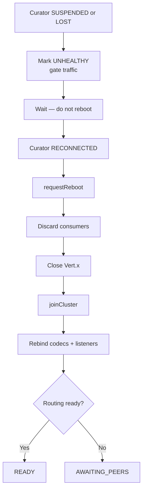
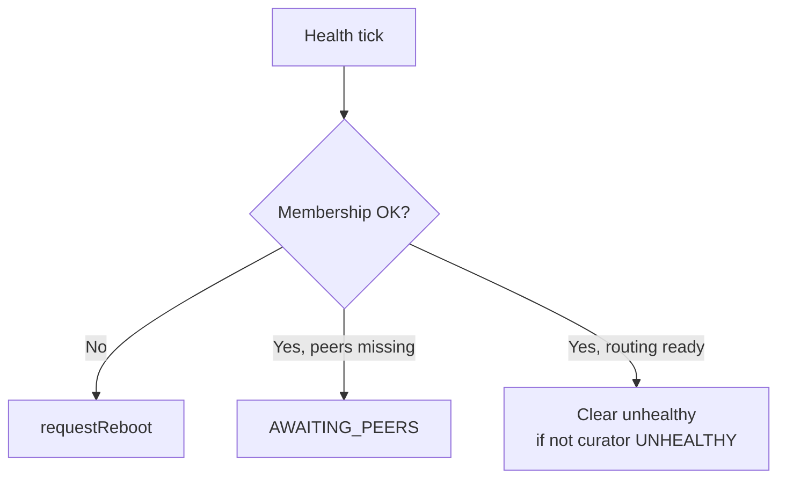
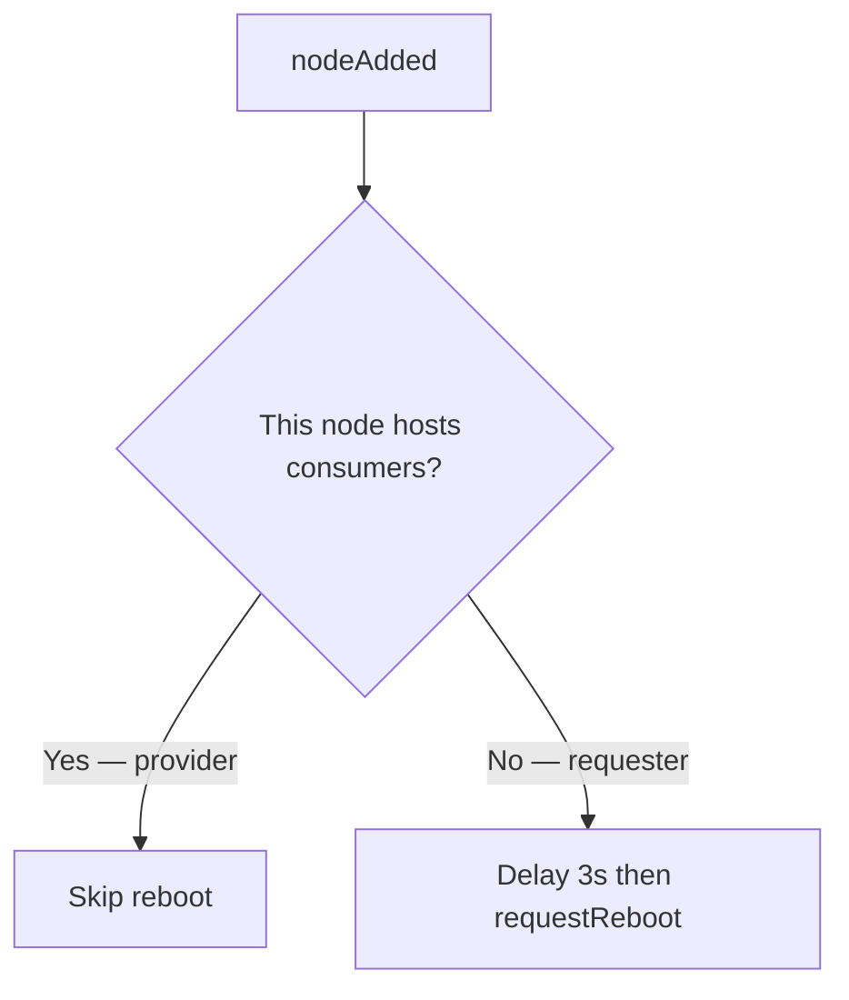

# Vert.x cluster recovery (ZooKeeper)

Recovery after a ZooKeeper outage is owned by `ClusterRecoveryCoordinator` and its strategies.
`VertxClient` only joins, closes, and holds Vert.x references.

**States:** `HEALTHY` → `UNHEALTHY` (Curator `SUSPENDED` / `LOST`) → `REBOOTING` (on `RECONNECTED`) → `AWAITING_PEERS` or `READY`.

## Happy path after join

## ZooKeeper outage → reboot → ready

## Scheduler health check only

## Peer joins the cluster

## Sequence

1. Join installs Curator and membership listeners; the reboot scheduler ticks about every 5 seconds.
2. Outage: `SUSPENDED` / `LOST` marks the cluster unhealthy and **defers reboot**. Waiting for cluster unregister would hang while ZooKeeper is down.
3. `RECONNECTED` arms a single-flight in-JVM reboot.
4. Teardown uses `EventConsumerRegistrar.discardAllConsumers()` (no cluster wait).
5. After rejoin: `CodecRegistrar.rebindAll()` then `WebClientResourceRegistrar.reregisterAll()`.
6. A requester with `maxObservedClusterSize > 1` stays in `AWAITING_PEERS` until peers are visible for two health ticks. The health check must not reboot in that state.
7. A provider skips peer-join reboot. A requester schedules a 3 second delayed reboot to refresh routing.
8. Traffic gate: `WebClientServiceProvider.isClusterReadyForTraffic()`.
