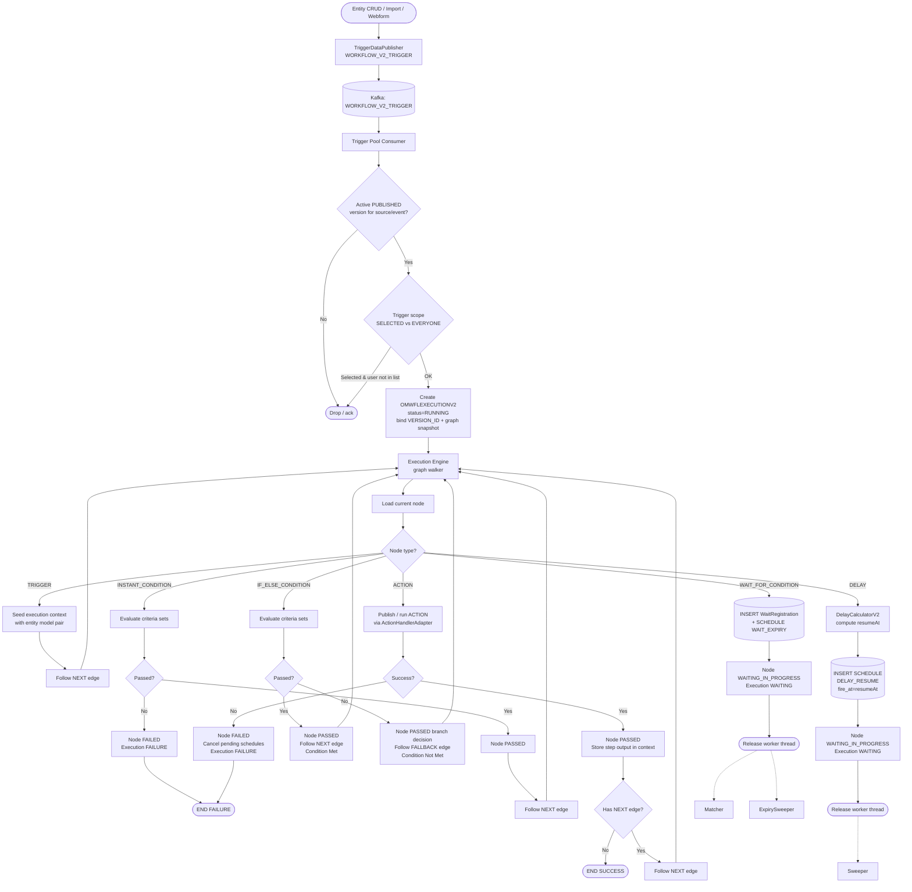
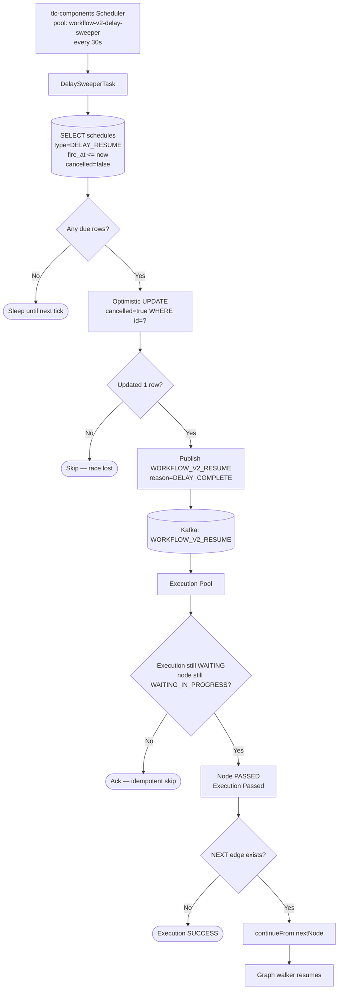
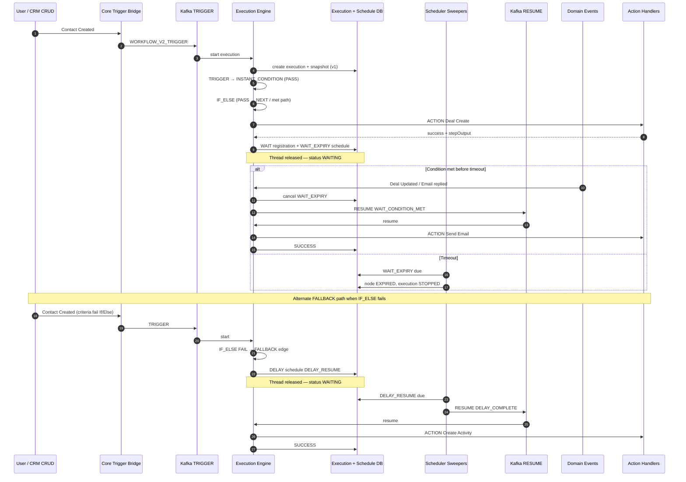

# Workflow V2 — Delay Scheduler & Wait-for-Condition Watcher

This document describes the end-to-end runtime design for **Delay** and **Wait for Condition** steps in Workflow V2, including thread management, failure/fallback handling, cancellation, and integration with the existing TLC scheduler and Kafka infrastructure.

It also includes an **end-to-end flowchart** covering all node types (Trigger, Instant Condition, If/Else, Action, Delay, Wait) with scheduler and watcher interactions.

---

## Table of Contents

1. [Overview](#1-overview)
2. [Architecture](#2-architecture)
3. [Core Concepts](#3-core-concepts)
4. [Delay Scheduler — Complete Process](#4-delay-scheduler--complete-process)
5. [Wait-for-Condition Watcher — Complete Process](#5-wait-for-condition-watcher--complete-process)
6. [Thread Pools & Maintenance](#6-thread-pools--maintenance)
7. [Fallback & Branch Handling](#7-fallback--branch-handling)
8. [Cancellation & Disable Flows](#8-cancellation--disable-flows)
9. [Failure Handling & Retries](#9-failure-handling--retries)
10. [Kafka Topics](#11-kafka-topics)
11. [End-to-End Flowchart (All Nodes + Scheduler + Watcher)](#14-end-to-end-flowchart-all-nodes--scheduler--watcher)
12. [Sequence Diagrams](#15-sequence-diagrams)

---

## 1. Overview

Workflow V2 is a **graph-based execution engine**. Unlike V1 (linear trigger → criteria → actions), V2 supports:

| Step type | Runtime behavior |
|-----------|------------------|
| **DELAY** | Pause execution until a computed time, then resume |
| **WAIT_FOR_CONDITION** | Pause until a domain event matches criteria OR timeout expires |
| **IF_ELSE_CONDITION** | Evaluate criteria; follow **NEXT** (met) or **FALLBACK** (not met) edge |

**Design principles:**

- **Durable state in DB** — delays and waits survive process restarts
- **Async execution via Kafka** — no long-running threads holding worker slots
- **Existing `tlc-components/scheduler`** — used only for periodic sweepers, not per-delay timers
- **Domain events for watching** — not CDC or row listeners on workflow tables
- **V1 untouched** — all V2 code, tables, and topics are suffixed/isolated

---

## 2. Architecture

```
┌─────────────────────────────────────────────────────────────────────────────┐
│                           WORKFLOW V2 RUNTIME                               │
├─────────────────────────────────────────────────────────────────────────────┤
│                                                                             │
│  ┌──────────────┐    ┌──────────────────┐    ┌─────────────────────────┐   │
│  │ Trigger      │───►│ Execution Engine │───►│ Node Executors          │   │
│  │ Router (V2)  │    │ (graph walker)   │    │ TRIGGER / CONDITION /   │   │
│  └──────────────┘    └────────┬─────────┘    │ ACTION / DELAY / WAIT   │   │
│                               │              └───────────┬─────────────┘   │
│                               │                          │                 │
│                    ┌──────────▼──────────┐    ┌──────────▼─────────────┐   │
│                    │ Execution State DB  │    │ Schedule Registry DB   │   │
│                    │ (executions,        │    │ (delay resume, wait    │   │
│                    │  node statuses)     │    │  expiry timestamps)    │   │
│                    └──────────┬──────────┘    └──────────┬─────────────┘   │
│                               │                          │                 │
│  ┌────────────────────────────▼──────────────────────────▼─────────────┐   │
│  │                         KAFKA                                       │   │
│  │   WORKFLOW_V2_TRIGGER  │  WORKFLOW_V2_RESUME  │  WORKFLOW_V2_ACTION │   │
│  └─────────────────────────────────────────────────────────────────────┘   │
│                               ▲                          ▲                 │
│  ┌────────────────────────────┴──────────┐    ┌──────────┴─────────────┐   │
│  │ Delay Sweeper (scheduler module)      │    │ Wait Matcher           │   │
│  │ polls due DELAY_RESUME schedules      │    │ (domain post-events)   │   │
│  └───────────────────────────────────────┘    └────────────────────────┘   │
│  ┌───────────────────────────────────────┐                                   │
│  │ Wait Expiry Sweeper (scheduler module)│                                   │
│  │ polls due WAIT_EXPIRY schedules       │                                   │
│  └───────────────────────────────────────┘                                   │
└─────────────────────────────────────────────────────────────────────────────┘
```

---

## 3. Core Concepts

### 3.1 Execution instance

One row in `OMWFLEXECUTIONV2` per trigger firing:

- Bound to `VERSION_ID` at start (immutable for that run)
- Stores `WORKFLOW_GRAPH_SNAPSHOT` (frozen definition for history UI)
- Tracks `CURRENT_NODE_ID` and overall `STATUS`

### 3.2 Execution node status

Each visited step has a row in `OMWFLEXECUTIONNODE`:

| Status | Meaning |
|--------|---------|
| `PENDING` | Not yet reached |
| `RUNNING` | Currently executing |
| `WAITING_IN_PROGRESS` | Delay or wait active |
| `PASSED` | Step completed successfully |
| `FAILED` | Step failed (action error, condition fail on blocking path) |
| `STOPPED` | Cancelled (disable workflow, remove user, edit with stop checkbox) |
| `EXPIRED` | Wait timeout without condition met |

### 3.3 Graph edges

Navigation uses `MWFLNODEEDGE`:

| Edge type | Used by | Meaning |
|-----------|---------|---------|
| `NEXT` | All nodes with a successor | Default / condition-met path |
| `FALLBACK` | `IF_ELSE_CONDITION` only | Condition-not-met path |

Payload mapping:

```json
"nextNode": 4      → EDGE(FROM=current, TO=4, TYPE=NEXT)
"fallbackNode": 5  → EDGE(FROM=current, TO=5, TYPE=FALLBACK)
```

### 3.4 Schedule registry

`OMWFLEXECUTIONSCHEDULER` holds **future work**:

| Schedule type | Purpose |
|---------------|---------|
| `DELAY_RESUME` | Fire when delay duration elapses |
| `WAIT_EXPIRY` | Fire when wait window expires without match |

---

## 4. Delay Scheduler — Complete Process

### 4.1 When execution reaches a DELAY node

```
1. Load spanConfiguration (predefined/custom, amount, unit, skipWeekends, dueTime)
2. Compute resumeAt via DelayCalculatorV2 (org timezone, weekend rules, max 30 days)
3. INSERT OMWFLEXECUTIONSCHEDULEV2:
     - execution_id, node_id
     - schedule_type = DELAY_RESUME
     - fire_at = resumeAt
     - cancelled = false
4. UPDATE OMWFLEXECUTIONNODEV2: status = WAITING_IN_PROGRESS
5. UPDATE OMWFLEXECUTIONV2: status = WAITING, current_node_id = delay_node_id
6. STOP graph walker — release execution thread
```

**Important:** The worker thread is **not blocked** for days. State is persisted; execution resumes asynchronously.

### 4.2 Delay calculation (`DelayCalculatorV2`)

Inputs:

- `type`: PREDEFINED | CUSTOM
- `amount`, `unit`: minutes | hours | days | weeks
- `skipWeekends`: boolean (not for "Next Monday" etc.)
- `dueTime`: optional HH:mm (15-min intervals) for day/week durations
- `timestamp`: optional anchor for predefined presets

Output: `resumeAt` epoch millis (validated ≤ 30 days from now)

### 4.3 Delay sweeper (uses existing scheduler module)

A **recurring** task — same pattern as `WorkflowExecutionHistoryCleaner`:

```java
// Pseudocode
schedulerService.schedule("workflow-v2-delay-sweeper-pool",
    new DelaySweeperTask(new IntervalController("workflow-v2-delay-sweeper", 30_000)));
```

**Every 30 seconds:**

```
1. SELECT * FROM OMWFLEXECUTIONSCHEDULEV2
   WHERE schedule_type = DELAY_RESUME
     AND fire_at <= NOW()
     AND cancelled = false
   LIMIT 100  (batch)

2. For each due schedule:
   a. Optimistic lock: UPDATE cancelled=true WHERE id=? AND cancelled=false
      (skip if 0 rows — another instance won the race)
   b. Publish WORKFLOW_V2_RESUME message:
      { executionId, nodeId, resumeReason: DELAY_COMPLETE }
   c. Log + metrics
```

**Multi-instance safety:** optimistic `cancelled` flag prevents duplicate resume in clustered deployments.

### 4.4 Resume consumer (`WORKFLOW_V2_RESUME`)

```
1. Consume message from Kafka
2. Submit to workflow-v2-execution-pool
3. Load execution (verify status = WAITING, not STOPPED)
4. Load execution node → verify WAITING_IN_PROGRESS
5. UPDATE node status → PASSED (Execution Passed in history UI)
6. Resolve NEXT edge from delay node
7. If no NEXT edge → mark execution SUCCESS (terminal delay)
8. Else → WorkflowExecutionEngineV2.continueFrom(nextNodeId)
```

---

## 5. Wait-for-Condition Watcher — Complete Process

### 5.1 Prerequisites

- At least one **ACTION** step must exist in the **same branch path** before WAIT is allowed (validated at save time)
- `eventInfo` references a prior step (`type: ACTION`, `stepId: <nodeId>`)

### 5.2 When execution reaches WAIT_FOR_CONDITION node

```
1. Resolve source node from eventInfo.stepId (trigger or action step)
2. Extract entityId / emailId from execution context for that step
3. INSERT OMWFLExecutionWaitRegistrationV2:
     - execution_id, node_id, source_node_id
     - entity_type, entity_id (and/or email_id)
     - expires_at = now + wait duration
4. INSERT OMWFLEXECUTIONSCHEDULEV2:
     - schedule_type = WAIT_EXPIRY
     - fire_at = expires_at
5. UPDATE execution node → WAITING_IN_PROGRESS
6. UPDATE execution → WAITING
7. STOP graph walker
```

### 5.3 Watcher — domain event driven (NOT CDC / row listener)

| Event source | When fired | Example |
|--------------|------------|---------|
| Entity UPDATE post-event | Contact/Deal/Company/Activity updated | Contact field changed |
| Email tracking | Sent, replied, clicked | Email reply received |

**WaitMatcherV2.onDomainEvent(event):**

```
1. Build lookup key: orgId + entityType + entityId (or emailId)
2. SELECT pending registrations WHERE key matches AND expires_at > NOW()
3. For each registration:
   a. Load wait node criteria + execution context
   b. Evaluate criteria against event payload (old/new model pair)
   c. If PASSED:
      - Cancel WAIT_EXPIRY schedule (cancelled=true)
      - Delete/deactivate registration
      - Publish WORKFLOW_V2_RESUME { resumeReason: WAIT_CONDITION_MET }
   d. If not matched → continue waiting
4. Return quickly — heavy work goes to Kafka resume consumer
```

### 5.4 Wait expiry sweeper

Same pattern as delay sweeper, `schedule_type = WAIT_EXPIRY`:

```
1. Poll due WAIT_EXPIRY schedules
2. Cancel schedule row
3. Load execution — if still WAITING on that node:
   a. UPDATE node → EXPIRED (Evaluation Expired in UI)
   b. UPDATE execution → STOPPED
   c. Do NOT follow NEXT edge
4. Clean up wait registration
```

### 5.5 Resume after wait match

Same `WORKFLOW_V2_RESUME` consumer as delay:

```
1. Verify node still WAITING_IN_PROGRESS
2. UPDATE node → PASSED
3. Follow NEXT edge from wait node
4. Continue graph
```

---

## 6. Thread Pools & Maintenance

### 6.1 Pool layout

| Pool name | Purpose | Sizing guidance |
|-----------|---------|-----------------|
| `workflow-v2-trigger-pool` | Kafka consumer for TRIGGER topic | 1–2 threads |
| `workflow-v2-execution-pool` | Node execution + RESUME processing | 10–20 |
| `workflow-v2-action-pool` | Action handler dispatch (optional) | 5–10 |
| `workflow-v2-delay-sweeper-pool` | Delay due-time poller | 1–2 |
| `workflow-v2-wait-expiry-pool` | Wait timeout poller | 1–2 |
| `workflow-v2-event-matcher-pool` | Optional async matcher offload | 2–5 |

### 6.2 What happens when all execution threads are busy?

| Component | Behavior |
|-----------|----------|
| **Kafka consumers** | Messages stay in topic; lag increases; processed when free |
| **Delay sweeper** | Due rows remain in DB; picked up on next sweep (max ~30s lag) |
| **Wait matcher** | Event processed; RESUME buffered in Kafka |
| **Domain CRUD** | Never blocked — workflow is fully async |

**No work is lost** because state is in DB + Kafka, not in-memory threads.

### 6.3 Graceful shutdown

```
1. Stop Kafka consumers
2. Stop delay/wait sweepers (schedulerService.removeTask)
3. Drain execution pool (timeout 60s)
4. In-flight RESUME messages remain in Kafka → reprocessed on restart
5. WAITING/DELAY executions safe in DB — sweepers resume on startup
```

---

## 7. Fallback & Branch Handling

### 7.1 IF_ELSE navigation

```
evaluate(condition) →
  if PASSED  → follow EDGE_TYPE=NEXT     (condition met path)
  if FAILED  → follow EDGE_TYPE=FALLBACK (condition not met path)
  if no FALLBACK edge and FAILED → execution FAILURE or STOPPED
```

### 7.2 Instant condition vs If/Else

| Node | Condition fails | Behavior |
|------|-----------------|----------|
| `INSTANT_CONDITION` on main path | FAILED | Stop execution; status FAILURE |
| `IF_ELSE_CONDITION` | FAILED | Follow FALLBACK branch (not global failure) |
| `WAIT_FOR_CONDITION` timeout | EXPIRED | STOPPED; no NEXT followed |

### 7.3 Action failure

```
Action returns null / throws →
  node status FAILED
  execution status FAILURE
  do NOT follow NEXT edge
  pending delay/wait schedules for this execution → cancelled
```

---

## 8. Cancellation & Disable Flows

| Action | Checkbox checked | Behavior |
|--------|------------------|----------|
| Disable workflow | Stop pending | Cancel all WAITING executions + schedules |
| Disable workflow | Unchecked | In-flight runs continue on bound `version_id` |
| Edit + save | Stop pending | Cancel then save new version |
| Remove user | Stop pending | Cancel only that user's pending executions |

---

## 9. Failure Handling & Retries

### Idempotent resume

```
IF execution.status IN (STOPPED, SUCCESS, FAILURE) → ack and skip
IF node.status != WAITING_IN_PROGRESS → ack and skip
ELSE → process resume
```

---

## 10. Kafka Topics

| Topic | Producer | Consumer |
|-------|----------|----------|
| `WORKFLOW_V2_TRIGGER` | CRM trigger bridge | V2 trigger router |
| `WORKFLOW_V2_RESUME` | Delay sweeper, wait matcher | V2 execution engine |
| `WORKFLOW_V2_ACTION` | Execution engine | Action dispatcher |

V1 topics (`TRIGGER_INITIATOR`, `ACTION_INITIATOR`) remain unchanged.


---

## 11. End-to-End Flowchart (All Nodes + Scheduler + Watcher)

### 11.1 Example automation graph

```
[1 TRIGGER] Contact Created
     │ NEXT
     ▼
[2 INSTANT_CONDITION]  (blocking filter)
     │ NEXT (passed only)
     ▼
[3 IF_ELSE_CONDITION]
     ├─ NEXT (met) ──────────────► [4 ACTION] Deal Create
     │                                  │ NEXT
     │                                  ▼
     │                             [5 WAIT_FOR_CONDITION] Deal Updated / Email replied
     │                                  │ NEXT (on match)
     │                                  ▼
     │                             [6 ACTION] Send Email
     │                                  │
     │                                  ▼
     │                                [END SUCCESS]
     │
     └─ FALLBACK (not met) ──────► [7 DELAY] 2 days
                                        │ NEXT (after delay)
                                        ▼
                                   [8 ACTION] Create Activity
                                        │
                                        ▼
                                      [END SUCCESS]
```

### 11.2 Master execution flowchart



### 11.3 Delay sweeper & resume path



### 11.4 Wait matcher & expiry paths

```mermaid
flowchart TD
    subgraph MatchPath [Condition Met Path]
        DomEvt[Domain Post Event<br/>Entity UPDATE / Email tracking] --> Matcher[WaitMatcherV2]
        Matcher --> Lookup[(Find WaitRegistration<br/>by org + entity/email)]
        Lookup --> Found{Pending registration?}
        Found -->|No| Ignore([Ignore event])
        Found -->|Yes| EvalW[Evaluate wait criteria]
        EvalW --> Met{Passed?}
        Met -->|No| KeepWaiting([Keep waiting])
        Met -->|Yes| CancelExp[Cancel WAIT_EXPIRY schedule]
        CancelExp --> PubM[Publish WORKFLOW_V2_RESUME<br/>reason=WAIT_CONDITION_MET]
        PubM --> KafkaM[(Kafka: WORKFLOW_V2_RESUME)]
        KafkaM --> ResumeM[Execution Pool<br/>node PASSED → follow NEXT]
    end

    subgraph ExpiryPath [Timeout Path]
        Sched2[Scheduler<br/>pool: workflow-v2-wait-expiry<br/>every 30s] --> ExpSweep[WaitExpirySweeperTask]
        ExpSweep --> QueryE[(SELECT WAIT_EXPIRY<br/>fire_at &lt;= now)]
        QueryE --> StillWait{Execution still WAITING<br/>on this wait node?}
        StillWait -->|No| Clean([Cleanup only])
        StillWait -->|Yes| Expire[Node EXPIRED<br/>Evaluation Expired]
        Expire --> StopExec[Execution STOPPED]
        StopExec --> NoNext([Do NOT follow NEXT])
    end
```



### 11.5 Combined swimlane (example run)



### 11.6 Thread ownership summary

```
┌────────────────────────┬──────────────────────────────────────────────────┐
│ Component              │ Thread / pool                                    │
├────────────────────────┼──────────────────────────────────────────────────┤
│ Trigger consumer       │ workflow-v2-trigger-pool (1–2)                   │
│ Graph walker / resume  │ workflow-v2-execution-pool (10–20)               │
│ Action handlers        │ same execution pool or workflow-v2-action-pool   │
│ Delay sweeper          │ workflow-v2-delay-sweeper-pool (scheduler, 1–2)  │
│ Wait expiry sweeper    │ workflow-v2-wait-expiry-pool (scheduler, 1–2)    │
│ Wait matcher           │ domain event thread (light) → Kafka RESUME       │
│ DELAY / WAIT wait time │ NO thread held — durable DB schedule only        │
└────────────────────────┴──────────────────────────────────────────────────┘
```

---

## 12. Sequence Diagrams

### 12.1 Delay flow

```
Trigger → Engine → DELAY node
  → DB: schedule (fire_at)
  → DB: execution WAITING
  → [thread released]

... time passes ...

Delay Sweeper (every 30s)
  → finds due schedule
  → Kafka: WORKFLOW_V2_RESUME

Resume Consumer
  → node PASSED
  → follow NEXT edge
  → continue graph (e.g. ACTION)
```

### 12.2 Wait for condition flow

```
Trigger → ... → ACTION → WAIT node
  → DB: wait registration
  → DB: schedule WAIT_EXPIRY
  → DB: execution WAITING
  → [thread released]

... domain event matches ...

WaitMatcherV2
  → cancel WAIT_EXPIRY
  → Kafka: WORKFLOW_V2_RESUME

Resume Consumer
  → node PASSED
  → follow NEXT edge
```

### 12.3 Wait expiry

```
WAIT node → waiting...
Wait Expiry Sweeper
  → due WAIT_EXPIRY
  → node EXPIRED
  → execution STOPPED
  → (no NEXT edge followed)
```

### 12.4 IF/ELSE with delay on fallback branch

```
IF_ELSE → condition FAILED
  → follow FALLBACK edge → DELAY node
  → [delay process]
  → after delay → NEXT on fallback branch
```

---
